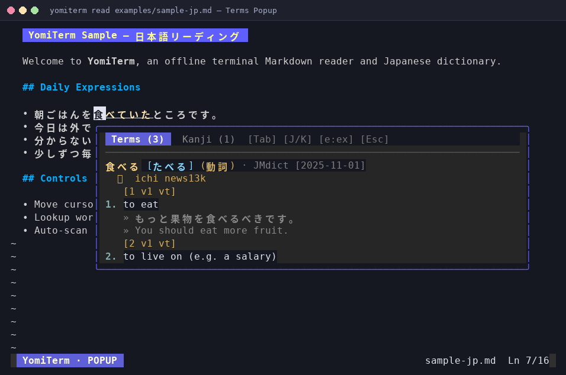
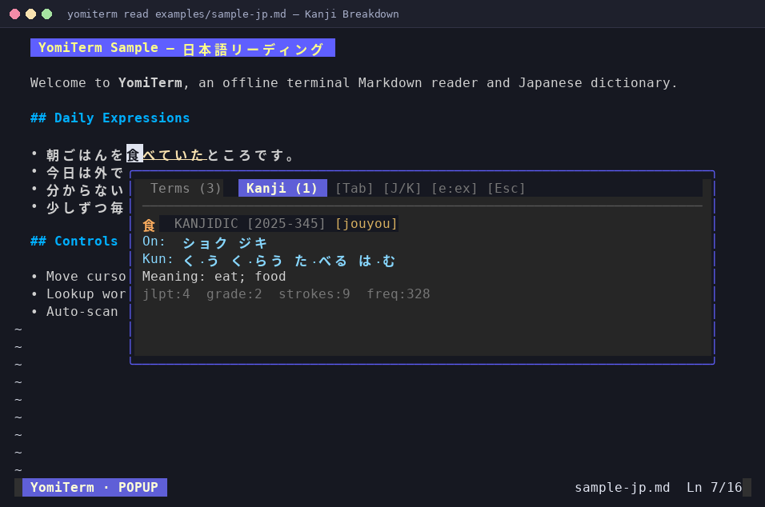
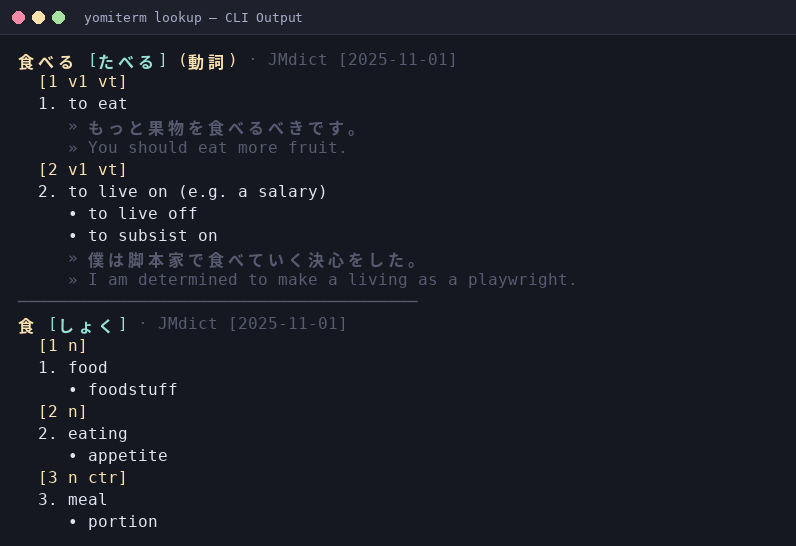

# YomiTerm

Yomitan-like Japanese & CJK dictionary lookup tool and interactive Markdown reader for terminal users.

Built in pure Go (`CGO_ENABLED=0`) using Bubble Tea, Lip Gloss, Glamour, Kagome, and `modernc.org/sqlite`.

## Screenshots

### Interactive TUI Markdown Reader — Terms Popup


### Interactive TUI Markdown Reader — Kanji Breakdown (`Tab`)


### Fast CLI Lookup (`yomiterm lookup`)


## Features

- **Interactive TUI Markdown Reader (`yomiterm read <file.md>`):**
  - `Glamour`-powered Markdown rendering with Vim/Helix (`hjkl`, `w`/`b`, `gg`/`G`, `/`) navigation.
  - Grapheme-cluster and East Asian display-width math (`uniseg` + `go-runewidth`) so mixed ASCII and 2-column CJK lines never drift.
  - Floating definition popup with **Terms** and **Kanji** breakdown tabs, scrolling, example toggle, and optional **Auto-Scan** mode (`a`).
- **Yomitan-Compatible Importer (`yomiterm import <dict.zip|dir>`):**
  - Imports Yomitan v3 `.zip` archives and extracted dictionary directories (ignoring Windows/WSL `:Zone.Identifier` files).
  - Supports `term_bank`, `kanji_bank`, `tag_bank`, `term_meta_bank`, `kanji_meta_bank`, and `structured-content` glossaries.
- **Morphological Analysis & Deinflection:**
  - Embedded `kagome` IPA morphological analyzer + colloquial contraction deinflector (`〜てる`, `〜てた`, `〜ちゃう`, `〜りゃ`, `〜なきゃ`, etc.) + longest-prefix scan and kanji fallback.
- **Fast CLI & `tmux` Integration (`yomiterm lookup`):**
  - Supports `--plain`, `--json`, `--kanji`, `--examples`, and `--clipboard` (`-c`) across **WSL2** (`win32yank.exe` / `powershell.exe`), Wayland (`wl-paste`), X11 (`xclip` / `xsel`), macOS (`pbpaste`), and `tmux`.

## Installation

### Build from Source

```bash
git clone https://github.com/harwHarw03/yomiterm.git
cd yomiterm
CGO_ENABLED=0 go build -o yomiterm .
```

Optionally install to your `$PATH`:

```bash
CGO_ENABLED=0 go install .
```

## Quick Start

### 1. Download & Import Dictionaries

Download official Yomitan-formatted **JMdict** and **KANJIDIC** archives into `dicts/`:

```bash
./download-dicts.sh
./yomiterm import dicts/JMdict_english_with_examples.zip
./yomiterm import dicts/KANJIDIC_english.zip
```

Manage imported dictionaries:

```bash
./yomiterm dict list
./yomiterm dict priority "JMdict [2025-11-01]" 10
./yomiterm dict disable 2
./yomiterm dict enable 2
```

### 2. Interactive TUI Markdown Reader

Try the included sample document:

```bash
./yomiterm read examples/sample-jp.md
```

#### Keybindings

| Context | Key | Action |
| :--- | :--- | :--- |
| **Navigation** | `h` / `j` / `k` / `l` (or Arrows) | Move cursor left / down / up / right |
| | `w` / `b` | Jump to next / previous word |
| | `0` / `$` | Start / end of line |
| | `gg` / `G` | Top / bottom of document |
| | `Ctrl+d` / `Ctrl+u` | Half-page down / up |
| **Lookup** | `Enter` or `Space` | Look up word at cursor and focus popup |
| | `a` | Toggle Auto-Scan mode (live popup while moving) |
| **Popup** | `J` / `K` or `Ctrl+d` / `Ctrl+u` | Scroll popup down / up |
| | `Tab` | Switch between **Terms** and **Kanji** tabs |
| | `e` | Toggle example sentences |
| | `Esc` | Close popup |
| **Search** | `/` | Incremental search (`n` / `N` for next / previous) |
| **General** | `?` | Toggle help bar |
| | `q` / `Ctrl+c` | Quit |

### 3. CLI Lookup & `tmux` Integration

```bash
./yomiterm lookup "食べていた"
./yomiterm lookup --plain "日本語の小説"
./yomiterm lookup --json "漢字"
./yomiterm lookup --clipboard
```

Generate a ready-to-paste `tmux.conf` snippet:

```bash
./yomiterm tmux-conf >> ~/.tmux.conf
```

## Configuration

YomiTerm reads `~/.config/yomiterm/config.toml` (or `$XDG_CONFIG_HOME/yomiterm/config.toml`) if present:

```toml
database_path = "~/.local/share/yomiterm/yomiterm.db"
show_examples = true
auto_scan = false
east_asian_ambiguous_width = 1
theme = "auto" # "auto", "dark", "light", "notty"
```

## Documentation

- [Architecture & Design](docs/architecture.md)

