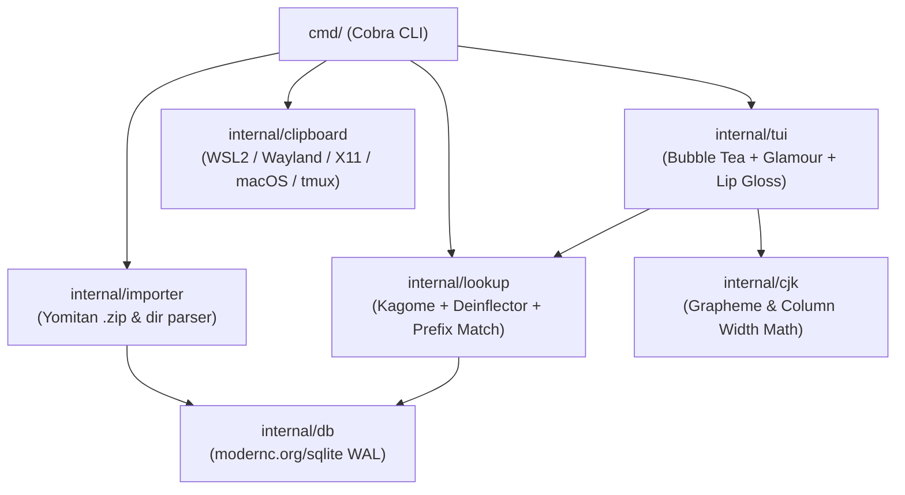

# YomiTerm Architecture

YomiTerm is an offline-first terminal Japanese/CJK dictionary and interactive Markdown reader written in pure Go (`CGO_ENABLED=0`).

## High-Level Design

YomiTerm separates the **storage and linguistic engine** (`internal/db`, `internal/importer`, `internal/lookup`) from the **presentation layers** (`internal/tui`, `cmd/`), allowing both sub-20ms headless CLI lookups (`tmux display-popup`) and the interactive TUI Markdown reader to share one engine.

## Directory Layout

- `cmd/` — Cobra CLI subcommands (`import`, `lookup`, `read`, `dict`, `tmux-conf`)
- `internal/config/` — XDG configuration (`config.toml`) and database path resolution
- `internal/db/` — Pure-Go SQLite (`modernc.org/sqlite`) connection, WAL PRAGMAs, embedded DDL (`schema.sql`), and indexed queries
- `internal/importer/` — Unified Yomitan v3 importer for `.zip` archives and extracted directories, including `structured-content` glossary parsing
- `internal/lookup/` — Kagome IPA morphological analyzer, colloquial contraction deinflector, longest-prefix scan, sense grouping, and Kanji fallback
- `internal/cjk/` — Grapheme cluster splitting (`uniseg`), East Asian display-width math (`go-runewidth`), and ANSI-safe popup compositing
- `internal/clipboard/` — Cross-platform clipboard reader (WSL2 `win32yank.exe`/`powershell.exe`, `wl-paste`, `xclip`/`xsel`, `pbpaste`, `tmux`)
- `internal/tui/` — Bubble Tea state machine, `Glamour` Markdown document mirror, floating popup, and incremental search

## SQLite Schema

YomiTerm stores imported Yomitan v3 dictionaries in six tables with B-tree indexes on `terms(expression)`, `terms(reading)`, `terms(dict_id, sequence)`, `kanji(character)`, `term_meta(expression)`, and `kanji_meta(character)`:

- `dictionaries` — Title, revision, format, display `priority` (lower = higher), and `enabled` toggle
- `tags` — Tag definitions (`name`, `category`, `notes`, `score`)
- `terms` — Dictionary headwords, readings, definition/term tags, deinflection rules, `glossary_json`, and `sequence`
- `kanji` — Character, on'yomi, kun'yomi, tags, `meanings_json`, and `stats_json`
- `term_meta` / `kanji_meta` — Pitch accent, frequency, and IPA metadata

Bulk imports wrap all inserts in a single transaction using prepared statements and temporary `PRAGMA synchronous = OFF` / `temp_store = MEMORY`, then restore `synchronous = NORMAL` with WAL mode for concurrent reads.

## Lookup Pipeline

Given up to 24 runes starting at the cursor position:

1. **Candidate Generation:**
   - **Longest-prefix scan** (16 runes down to 1) to catch multi-morpheme compounds and grammar expressions.
   - **Kagome morphological analysis** (`kagome-dict/ipa`) merging verb/adjective stems with trailing auxiliaries (`助動詞`, `接続助詞`, `接尾`/`非自立` verbs) to extract dictionary base forms (e.g. `食べていた` → `食べる`, `染められた` → `染める`).
   - **Colloquial contraction expansion** (`〜てる` → `〜ている`, `〜てた` → `〜ていた`, `〜ちゃう` → `〜てしまう`, `〜りゃ` → `〜れば`, `〜なきゃ` → `〜なければ`) re-analyzed with Kagome while preserving original surface span length.
   - **Katakana-to-Hiragana normalization** for reading matches.
2. **Batched SQLite Query:**
   - Single parameterized `IN (...)` query across enabled dictionaries.
3. **Grouping & Ranking:**
   - Rows sharing `(dict_id, sequence)` are grouped into numbered senses.
   - Entries are ranked by: matched surface length (DESC) → exact expression match → dictionary priority (ASC) → term score (DESC).
4. **Kanji Fallback:**
   - Unique CJK Unified Ideographs in the matched span (or first 4 runes if no term matched) are queried from `kanji`.

## CJK Layout & Popup Compositing

Rendering Markdown with `Glamour` produces lines containing ANSI SGR sequences alongside 1-column ASCII and 2-column CJK characters:

- Each visual line is parsed into `CellToken`s (`Grapheme`, `Width`, `StartCol`, `Style`, `PlainByteStart`) using `uniseg` and `go-runewidth`.
- Vertical cursor movement (`j`/`k`) tracks a sticky `DesiredCol` and snaps to the nearest grapheme at that visual column so mixed ASCII/CJK lines never drift.
- Floating popups are placed dynamically below or above the cursor and composited using ANSI-aware column slicing, replacing any straddled 2-column CJK character on the popup border with a space so terminal alignment remains exact.

## Terminal & Platform Support

- **WSL2 (Windows 11):** Automatically detected via `WSL_DISTRO_NAME` / `WSL_INTEROP`; clipboard reads fall back from `win32yank.exe` to UTF-8 `powershell.exe Get-Clipboard`.
- **Linux Terminals (Terminator, Kitty, Alacritty, WezTerm, GNOME Terminal):** Uses standard TrueColor/256-color Lip Gloss styling and configurable `east_asian_ambiguous_width` (`1` by default) in `config.toml`.
- **`tmux`:** `yomiterm tmux-conf` outputs ready-to-use `display-popup` bindings.
